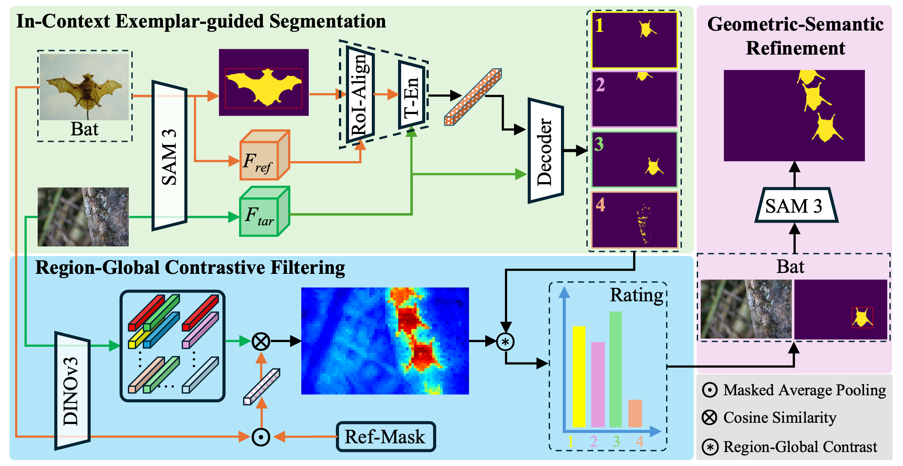

<div align="center">

# GFR-SAM: Training-Free Referring Camouflaged Object Segmentation via Cross-Image Prompting

<p align="center">
  <a href="https://arxiv.org/pdf/2607.11732"></a>
</p>

[Yilong Yang](https://scholar.google.com/citations?hl=en&user=aVWK3KQAAAAJ&view_op=list_works&sortby=pubdate) ·
Jianxin Tian ·
[Shengchuan Zhang](https://scholar.google.com/citations?user=GToqXScAAAAJ&hl=en) ·
[Liujuan Cao](https://scholar.google.com/citations?user=iYEcVaAAAAAJ&hl=en)

Key Laboratory of Multimedia Trusted Perception and Efficient Computing, Ministry of Education of China, Xiamen University, Xiamen, China 


</div>
<p align="center">
  
</p>

## 🔥 News

- **[2026/07/26]** Paper and code are released.

## ⚙️ Environment Setup

### Prerequisties
- Python 3.12 or higher
- PyTorch 2.7 or higher
- Transformers 5.0.0 or higher
- CUDA-compatible GPU with CUDA 12.6 or higher

1. **Clone the repository and install the package:**
```bash
git clone https://github.com/ynulonger/GFR-SAM.git
cd sam3/sam3
pip install -e .
```
2. **Prepare checkpoints:**

   GFR-SAM relies on frozen DINOv3 and SAM3 backbones. Please download the pretrained weights from the official repository:
   
   👉 https://huggingface.co/facebook/sam3</p>
   👉 https://huggingface.co/facebook/dinov3-vitb16-pretrain-lvd1689m

   Place the weights and configuration files of the backbone under the hf-sam3 and hf-dinov3 folders.
3. **Dataset preparation:**

    Download the [R2C7K](https://pan.baidu.com/s/1LHdqpD3w24fcLb_dbR6DyA) dataset and replace the path of the dataset in the ref-sam3.ipynb.
4. **Test and Visualisation:**

    Run the ref-sam3.ipynb to perform in-context segmentation and visualise both  intermediate and final output masks.

## Citation

If you find this work useful in your research, please cite:

```bibtex
@inproceedings{cuttano2026insid3,
  title     = {GFR-SAM: Training-Free Referring Camouflaged Object Segmentation via Cross-Image Prompting},
  author    = {Yilong Yang, Jianxin Tian, Shengchuan Zhang, Liujuan Cao},
  booktitle = {34th ACM International Conference on Multimedia (ACM MM)},
  year      = {2026}
}
```

## Acknowledgements

We gratefully acknowledge the contributions of the following open-source projects:

- [DINOv3](https://github.com/facebookresearch/dinov3)
- [SAM3](https://github.com/facebookresearch/sam3)